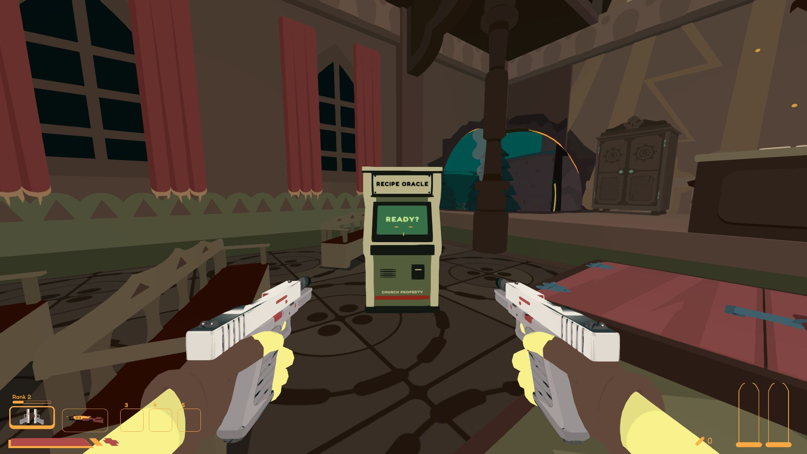
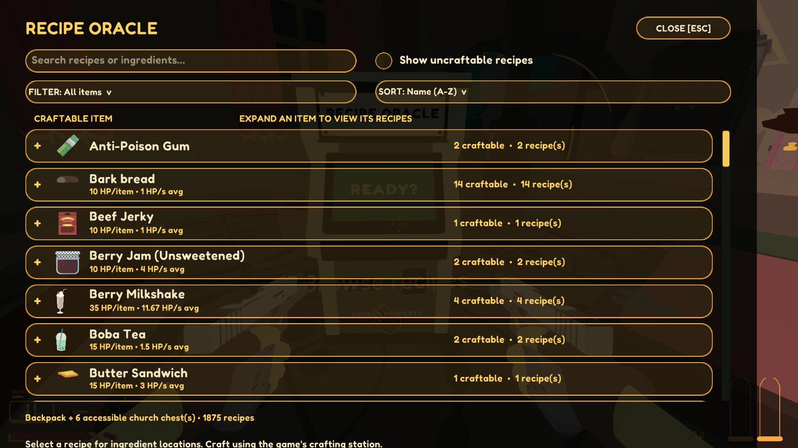
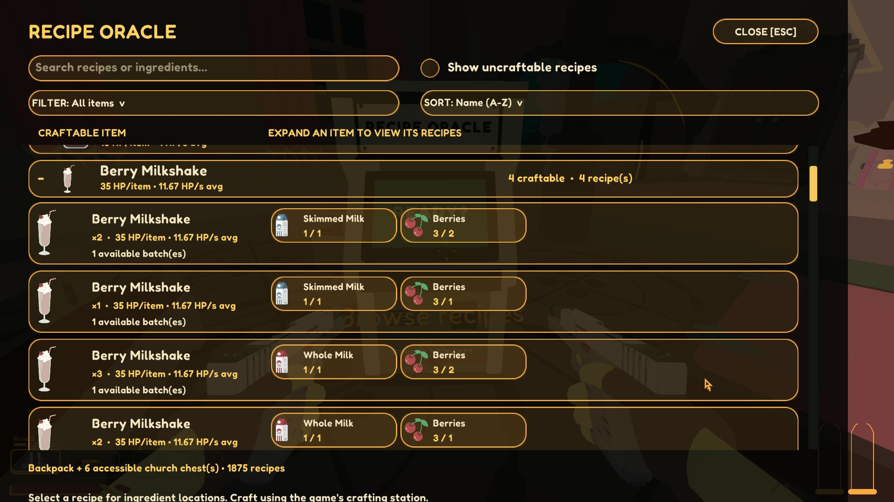
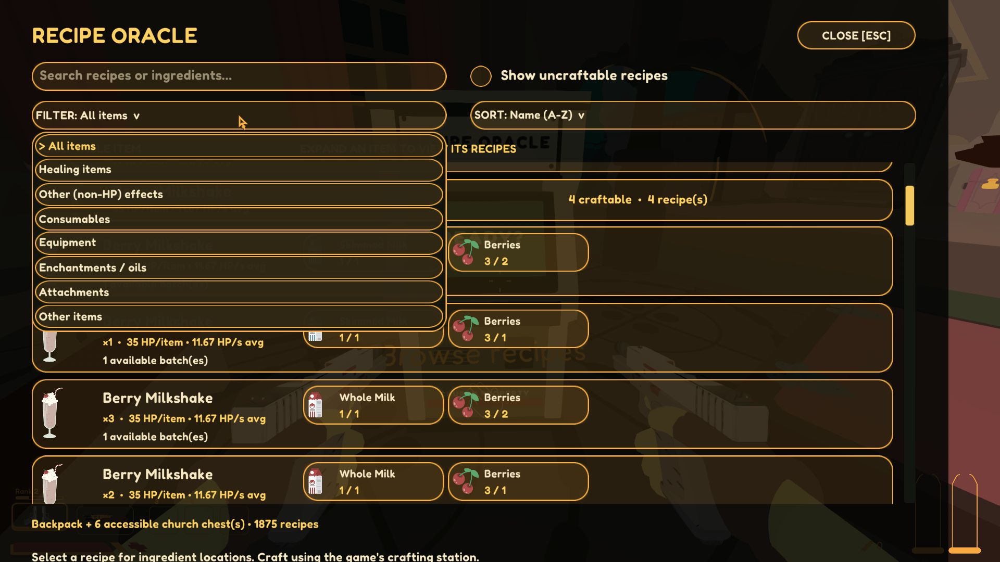

# SULFUR Crafting Arcade

**By zbaloc · Version 1.0.0 · GPL-3.0**

A recipe helper that lives inside SULFUR's church. Buy the **Crafting Arcade**
from Arthur for **10 stamps**, then use the arcade cabinet beyond the left front
pew to see what you can make from your backpack and accessible church chests.

## Screenshots

The arcade cabinet inside the church, beyond the left front pew:



The browser starts with craftable items grouped into expandable rows:



Expand an item to compare recipe variants, output quantities and **owned / required** ingredients:



<details>
<summary>View the item and effect filters</summary>



</details>

Screenshots were captured in-game with the reveal-all recipe setting enabled for testing.
Fresh installs show learned recipes by default. SULFUR artwork belongs to its respective owners.

## Features

- Combines backpack and church storage ingredient quantities without counting the same chest twice.
- Shows craftable recipes by default. Check **Show uncraftable recipes** to include gray incomplete recipes.
- Groups recipe variants under expandable output headings such as Bread. Detailed rows are created when a group is opened.
- Displays the output item, ingredient pictures, and **owned / required** quantities in long native-style inventory slots.
- Supports search, scrolling, ingredient locations, and item/effect filters.
- Sorts by healing amount, healing speed, craftable output quantity, ingredient units, or name.
- Restricts recipes to those learned by the active save by default, with an optional reveal-all setting.
- Uses the installed game's materials, fonts and artwork at runtime, with an original arcade cabinet model.

This is a recipe viewer. Craft items at SULFUR's existing crafting stations.

## Requirements

- SULFUR for Windows, Steam edition.
- **BepInEx 5 Mono x64**. The Thunderstore package declares BepInExPack as a dependency.
- Tested against the locally installed game using Unity 6000.3.22 and BepInEx 5.4.23.3.

Game updates may change the internal methods or church layout the mod uses.

## Installation

### Mod manager

Choose SULFUR in a compatible Thunderstore mod manager, install **Crafting Arcade**,
and launch the modded game. BepInExPack should be installed automatically.

### Manual / Nexus Mods

1. Close SULFUR.
2. Install [BepInEx 5 x64](https://github.com/BepInEx/BepInEx/releases/tag/v5.4.23.3) into the game folder and run the game once.
3. Extract the mod's ZIP into the SULFUR game folder, merging the `BepInEx` folders.
4. Confirm the DLL is at `BepInEx/plugins/SulfurCraftingArcade/SulfurCraftingArcade.dll`.
5. Launch, load a save, and buy **CRAFTING ARCADE** in Arthur's stamp upgrade menu.
6. Approach the cabinet and use the normal interact control when **Browse recipes** appears.

To update, close the game and replace the old mod DLL. Keep only one copy of the plugin.

## Configuration

After the first launch, edit `BepInEx/config/blake.sulfur.craftingarcade.cfg` while the game is closed.

| Section / setting | Default | Purpose |
|---|---|---|
| Machine / StampPrice | 10 | One-time stamp price; minimum zero. |
| Recipes / OnlyUnlockedRecipes | true | Limit the list to recipes learned by the active save. Set false to reveal all enabled recipes. |
| Machine / RotationOffset | -25 | Additional cabinet yaw in degrees. |
| Machine / PlaceAcrossRoom | true | Place inside the church beyond the left front pew. |
| Machine / VendorLocalOffset | 2.2, 0, 0 | Manual vendor-relative placement, used only when PlaceAcrossRoom is false. |
| Debug / EnableF8 | false | Open the viewer at church with F8 for testing without purchasing. |

Restart the game after changing configuration. Existing personal settings are preserved
when upgrading. The legacy plugin/config identifier remains stable for existing saves.

## Filters and sort values

Filters cover healing items, other non-HP effects, consumables, equipment,
enchantments/oils, attachments and miscellaneous items. Mixed-effect foods can
appear in both healing and other-effects views.

**HP gain** is base restored HP per output item. **HP/s** is average timed healing
over the longest healing duration; instant healing is prioritized in the fastest
sort. These values exclude player bonuses and the cap imposed by missing HP.
**Craftable items** counts available batches multiplied by output quantity.
**Ingredient units** counts total required quantities per batch. Craftable groups
and variants remain ahead of incomplete ones.

Each recipe is evaluated independently. Shared ingredients are not reserved, and
the browser does not plan chains of intermediate crafts. Attached item contents,
locked/inactive chests and inaccessible world containers are not counted.

## Save data and removal

Purchasing spends stamps through the game API and saves an unlock per save slot.
No custom inventory item is written to the save. Back up a save before trying a new mod.

To remove the mod, close the game and remove its DLL. The unused unlock entry may
remain in the save, and stamps spent on the machine are not refunded.

## Source, builds and contributions

Source: [zbaloc/SULFUR-Crafting-Arcade](https://github.com/zbaloc/SULFUR-Crafting-Arcade).

PowerShell 7 supplies the Roslyn compiler used by the build script. No .NET SDK is required.
You must provide your own installed game and BepInEx assemblies; they are not redistributable here.

```powershell
./Build.ps1 -GamePath 'D:\SteamLibrary\steamapps\common\SULFUR'
# If BepInEx is stored in a separate mod-manager profile:
./Build.ps1 -GamePath 'D:\SteamLibrary\steamapps\common\SULFUR' -BepInExCore 'D:\ModProfile\BepInEx\core'
./Test.ps1
```

The compiled DLL is written into this checkout's `BepInEx/plugins/SulfurCraftingArcade` folder.
Builds do not install into the game automatically. Thirty matching/grouping/filter/sort
checks pass, and the cabinet/UI have been iterated through user playtesting. This
is not a claim of compatibility with every game build, language or other mod.

Bug reports and pull requests are welcome. See [CONTRIBUTING.md](CONTRIBUTING.md).

## License and credits

Copyright (c) 2026 **zbaloc**. Original mod code and package artwork are under
**GNU GPL version 3 only**, with the SULFUR/Unity linking permission in
[LINKING-EXCEPTION](LINKING-EXCEPTION). Distributed modifications must retain
GPL licensing and provide corresponding source. See [LICENSE](LICENSE).

This is an unofficial fan mod, not affiliated with Perfect Random. SULFUR and
its assets belong to their respective owners. BepInEx and Harmony retain their
own licenses. See [NOTICE](NOTICE).
